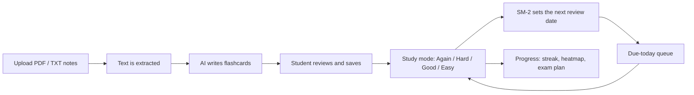

# AI Study Planner

> Upload your notes, get exam-ready.

[](https://github.com/Sneha629/AI_Study_Planner/actions/workflows/ci.yml)

AI Study Planner turns a student's notes into flashcards with AI, then schedules revision with spaced repetition (SM-2) so the right cards come back on the right day, all the way to the exam.

**Live app:** https://ai-study-planner-one-liart.vercel.app
**API health check:** https://ai-study-planner-gvwl.onrender.com/api/health

> The API runs on a free Render instance that sleeps after 15 minutes without traffic, so the first request can take about a minute.

---

## How it works



## Features

| # | Feature | What it does |
| --- | --- | --- |
| F1 | Auth | Sign up, log in, log out with JWT. Passwords hashed with bcrypt. Settings and change password. |
| F2 | Subjects and decks | Organise cards into subjects (e.g. Physics) and decks (e.g. Chapter 3) |
| F3 | Exam date | Each subject can have an exam date; shown as "Exam in X days" |
| F4 | Manual cards | Create, edit, delete and search flashcards |
| F5 | Upload notes | Upload a PDF or TXT (up to 5 MB); the text is extracted and kept |
| F6 | AI card generation | Google Gemini writes 10, 20 or 30 cards from a note; edit or untick them in a preview before saving |
| F7 | Study mode | 3D flip cards, keyboard shortcuts (Space to flip, 1-4 to rate), progress bar, session summary |
| F8 | SM-2 | Spaced repetition: each button shows when the card will come back |
| F9 | Due-today queue | Only the cards due today, within the student's daily review and new-card limits |
| F10 | Exam planner | New cards per day needed to finish before the exam, on-track or behind, and the next 7 days |
| F11 | Streaks | Current and longest run of study days, in the student's time zone |
| F12 | AI quiz | Multiple-choice quiz (5 or 10 questions) generated from a deck, with score and answers |
| F13 | Share deck | Public link to a deck (no login needed); others can copy it into their account |
| F14 | Dashboard | Progress page with streak, study heatmap and progress per subject |

**Also:** responsive layout for phones, password strength meter, remember-my-email, Caps Lock warning, rate limits on login and AI requests, and automatic fallback to other Gemini models when one is busy.

## Tech stack

| Layer | Technology |
| --- | --- |
| Frontend | React 19, Vite, Tailwind CSS 4, React Router 7, Axios, React Hot Toast |
| Backend | Node.js 20+, Express 5, Zod (validation), Multer (uploads), pdf-parse, express-rate-limit |
| Database | MongoDB with Mongoose (MongoDB Atlas in production) |
| Auth | JWT (jsonwebtoken) + bcryptjs |
| AI | Google Gemini through its OpenAI-compatible API (provider can be switched in `.env`) |
| Testing | Jest + Supertest, 130+ API tests; GitHub Actions runs them on every pull request |
| Hosting | Vercel (client), Render (server), MongoDB Atlas (database) |

## Project structure

```
AI_Study_Planner/
├── client/                    React app (Vite)
│   ├── vercel.json            Sends every route to index.html
│   └── src/
│       ├── api/               Axios instance (adds the JWT) and API helpers
│       ├── components/        Navbar, forms, auth layout, password strength, ...
│       ├── context/           AuthContext (current user, login, logout)
│       ├── pages/             One file per route (Study, Notes, Quiz, Progress, ...)
│       └── utils/             SM-2 preview for the study buttons
├── server/                    Express API
│   ├── src/
│   │   ├── app.js             Express app (exported for tests)
│   │   ├── index.js           Connects to MongoDB and starts the server
│   │   ├── models/            User, Subject, Deck, Card, Note, Review, QuizAttempt, Streak
│   │   ├── routes/            auth, subjects, decks, cards, notes, study, stats, quizzes, shared
│   │   ├── services/          llm, cardGenerator, quizGenerator, sm2, extractText
│   │   ├── middleware/        auth, validate, upload, errorHandler
│   │   ├── validators/        Zod schemas
│   │   └── utils/             Dates in the student's time zone
│   └── tests/                 Jest + Supertest (the AI is mocked)
├── docs/API.md                Request and response shapes for every route
├── .github/                   CI workflow, PR and issue templates
└── CONTRIBUTING.md            Team Git workflow
```

## Run it locally

**You need:** Node.js 20+, Git, MongoDB (installed locally, or a free [MongoDB Atlas](https://www.mongodb.com/atlas) cluster), and a free Gemini key from [Google AI Studio](https://aistudio.google.com) for the AI features.

```bash
git clone https://github.com/Sneha629/AI_Study_Planner.git
cd AI_Study_Planner

# Backend
cd server
npm install
cp .env.example .env     # fill in MONGODB_URI, JWT_SECRET and LLM_API_KEY
npm run dev              # http://localhost:5000/api/health

# Frontend (second terminal)
cd client
npm install
npm run dev              # http://localhost:5173
```

In development the Vite dev server forwards `/api` to `http://localhost:5000`, so the client needs no `.env`.

## Environment variables

**server/.env** (see `server/.env.example`)

| Name | Purpose |
| --- | --- |
| `PORT` | API port (default 5000; Render sets it) |
| `CLIENT_URL` | Sites allowed to call the API, comma separated (e.g. the Vercel URL) |
| `MONGODB_URI` | MongoDB connection string |
| `JWT_SECRET` | Secret for signing login tokens (long and random) |
| `JWT_EXPIRES_IN` | Token lifetime, e.g. `7d` |
| `LLM_API_KEY` | Gemini key, server only, never sent to the browser |
| `LLM_BASE_URL`, `LLM_MODEL`, `LLM_FALLBACK_MODEL` | Optional: change the AI provider or models |

**Client (Vercel only)**

| Name | Purpose |
| --- | --- |
| `VITE_API_URL` | Deployed API, e.g. `https://ai-study-planner-gvwl.onrender.com/api` |

## Scripts

| Where | Command | What it does |
| --- | --- | --- |
| server | `npm run dev` | Start the API with auto-reload |
| server | `npm test` | Run the Jest tests (needs MongoDB on localhost) |
| server | `npm start` | Start the API (production) |
| client | `npm run dev` | Start the React dev server |
| client | `npm run build` | Production build into `client/dist` |
| client | `npm run lint` | Lint the frontend |

## Deployment

| Part | Where | Settings |
| --- | --- | --- |
| Database | MongoDB Atlas (free M0) | Network access `0.0.0.0/0`, a database user, database `ai-study-planner-prod` |
| API | Render web service | Branch `main`, root `server`, build `npm ci`, start `npm start`, health check `/api/health`, env vars above |
| Client | Vercel | Branch `main`, root `client`, preset Vite, env `VITE_API_URL` |

Merging into `main` redeploys both automatically. All work goes to `develop` first through pull requests; see [CONTRIBUTING.md](CONTRIBUTING.md).

## API

Every route, its body, response and errors are listed in [docs/API.md](docs/API.md). All routes except auth, health and shared decks need `Authorization: Bearer <token>`, and a user can only ever see their own data.

## Team

| Member | Role | Main work |
| --- | --- | --- |
| Sneha | Team lead, backend | Project setup and Git workflow, CI, auth API, cards, notes upload, AI flashcards, SM-2, due-today queue, study mode, navbar and login pages, change password, deployment, PR reviews and releases |
| Khushi | Frontend + backend | Decks API and UI, subjects and home pages, cards UI, share deck, exam planner, AI quiz |
| Lavisha | Frontend | Login and signup UI, auth context and protected routes, settings page, progress dashboard |
| Kirti | Backend | Subjects API, settings API, stats and streak API |

## What's next

- "Generate more" AI cards from the same note without repeating earlier cards
- Faster generation for 20 and 30 cards
